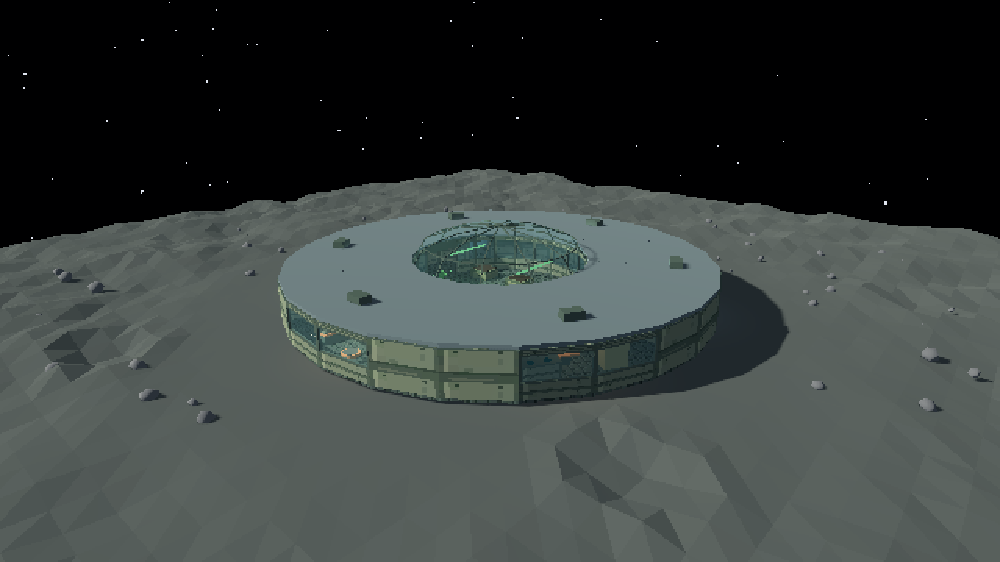
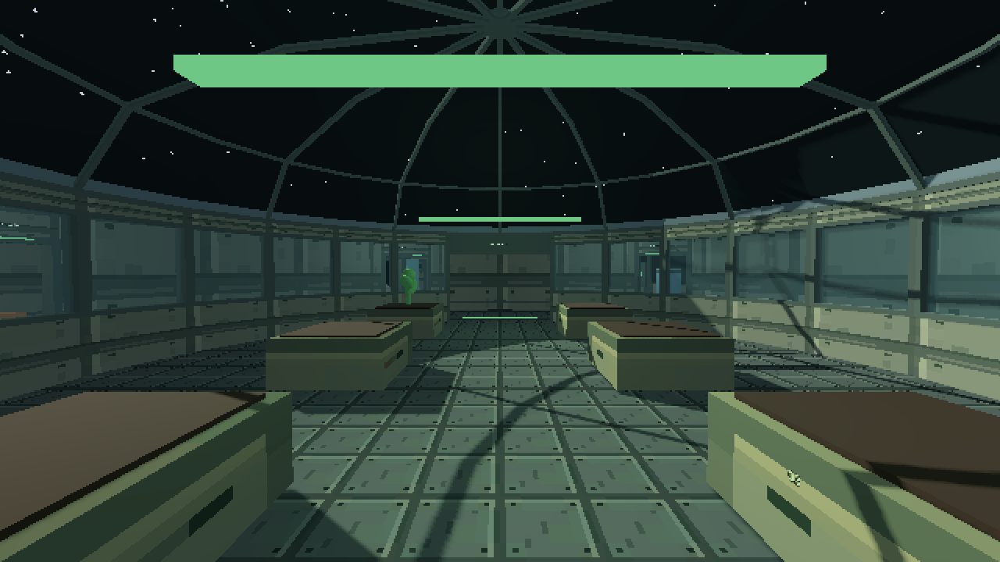
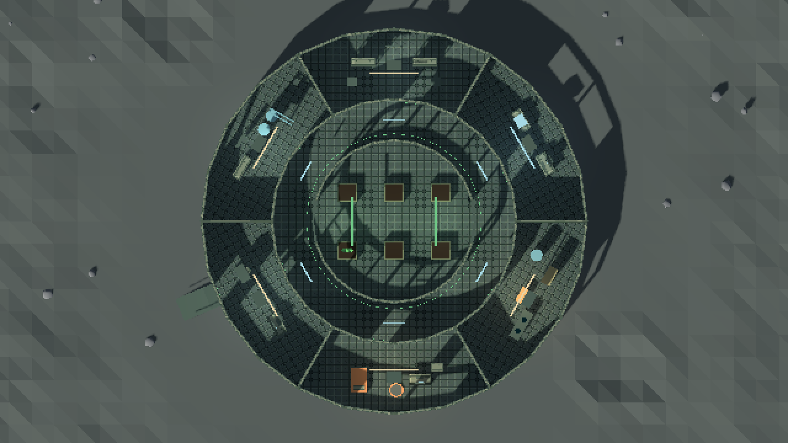

# Lunar Garden

3D-прототип игры про лунную станцию с оранжереей, сделанный на **Godot 4 / GDScript**.
Визуальный стиль — **PSX / retro low-poly**: простые объёмные формы, пиксельное
изображение и звёздное небо над поверхностью Луны.

Сейчас можно исследовать станцию от первого лица, заходить в комнаты,
осматривать грядки и выходить через шлюз на лунную поверхность.
Это ранний прототип: выращивание растений, ресурсы, исследования, сон,
сюжет и сохранения пока не реализованы.



## Как запустить

В репозитории находятся **исходники проекта**. Для запуска нужен установленный
**Godot Engine Standard**, версия **4.7.2** — на ней проект проверен.
Версия .NET, Blender и сторонние плагины не требуются.
Godot можно скачать с [официального сайта](https://godotengine.org/download/).

### Через редактор Godot

1. Скачай проект: на GitHub нажми **Code → Download ZIP** и распакуй архив.
   Либо клонируй репозиторий командой ниже.
2. Запусти Godot. В менеджере проектов нажми **Import / «Импорт»**.
3. Выбери файл **`project.godot`** в распакованной папке и открой проект.
4. Дождись первого импорта ресурсов.
5. Нажми **F5** или кнопку **▶ Run Project** в правом верхнем углу.
6. В главном меню игры нажми **«Начать»**.

Игрок появится в жилой каюте. Выход из неё ведёт в кольцевой коридор:
по нему можно обойти станцию и попасть во все комнаты.
Если мышь не управляет камерой, щёлкни по изображению игры
или нажми кнопку захвата мыши.

### Через терминал

Если Git и Godot доступны в `PATH`:

```sh
git clone https://github.com/AngelicaSeliwerstova/Game_jam_cosmos.git
cd Game_jam_cosmos
godot --editor --path .
```

После импорта нажми **F5**. При последующих запусках можно открыть игру сразу:

```sh
godot --path .
```

Если команда `godot` не найдена, используй запуск через редактор из инструкции выше.
Сам движок и его локальная папка `.tools/` в репозиторий не входят.

## Управление

| Клавиша | Действие |
| --- | --- |
| **W / A / S / D** | Ходьба |
| **Shift + WASD** | Бег (удерживать Shift) |
| **Пробел** | Прыжок |
| **Мышь** | Обзор |
| **E** | Осмотреть ближайшую грядку под прицелом |
| **E / Esc** при осмотре | Закрыть панель осмотра |
| **Esc** во время игры | Пауза |
| **Esc / «Продолжить»** в паузе | Вернуться в игру |
| **ЛКМ по изображению / кнопка захвата мыши** | Вернуть управление камерой |

В меню паузы также можно вернуться в главное меню.
Когда открыта панель осмотра или пауза, движение и обзор отключены.

## Что уже есть

- Круглая одноэтажная станция с центральной оранжереей и остеклённым куполом.
- Диаметр станции — 34 м, коридоры шириной около 3,65 м; проходы между грядками — от 2,3 м.
- Шесть отдельных грядок с подсветкой и осмотром по E.
- Кольцевой коридор и два противоположных входа в оранжерею.
- Жилая каюта, кухня, лаборатория, склад, технический отсек и шлюз с постом связи.
- Базовая мебель, оборудование, таблички, окна и коллизии.
- Лунный грунт, кратеры, камни, звёзды и солнечный свет.
- Выход на поверхность по пандусу и возвращение без прыжка.
- Главное меню, пауза и интерфейс в полном разрешении окна.

Ходьба — 2,7 м/с, бег — 5,2 м/с. Прыжок доступен с опоры, без двойного прыжка
в воздухе. Камера плавно следует за физическим движением; поворот мышью
обрабатывается без дополнительного сглаживания. Коллизия пола станции единая,
без внутренних стыков возле грядок.

3D-сцена рисуется в **640×360** и увеличивается без сглаживания.
Используется рендерер **Compatibility**. Пресет Web-экспорта подготовлен,
но браузерная сборка этой версии ещё не проверена.

## Скриншоты

Оранжерея изнутри:



План станции сверху; крыши скрыты только для этого снимка:



## Для разработки

- `project.godot` — проект Godot и точка входа.
- `scenes/main_menu/` — главное меню.
- `scenes/greenhouse/greenhouse.tscn` — игровая сцена с интерфейсом; её можно запустить через **F6**.
- `scenes/greenhouse/greenhouse_world.tscn` — станция для редактирования в 3D.
- `scenes/player/` — игрок от первого лица.
- `scenes/planting_slot/` — переиспользуемая грядка.
- `scenes/station/modules/` — модули мебели и оборудования.
- `scripts/` — игровые скрипты; `assets/` — материалы, текстуры и тема интерфейса.
- `tools/` — инструменты сборки сцены и автоматической проверки.

Комнаты и предметы сохранены обычными узлами: запускать генератор перед игрой
не нужно. Подробности редактирования, проверки и Web-экспорта —
в [руководстве разработчика](docs/development.md).

Выполнен графический прогон на Godot 4.7.2 / Compatibility:
**80 автоматических проверок прошли**. Проверены проходы, доступ к грядкам,
взаимодействия, бег, прыжок и приземление, движение у грядок, пауза, переходы меню и пандус.
[Отчёт и ограничения проверки](docs/station/verification.md).

## Перенос в Blender

Открой `scenes/greenhouse/greenhouse_world.tscn` в Godot и выбери
**Scene → Export As… → glTF 2.0 Scene…**, формат **`.glb`**.
В Blender используй **File → Import → glTF 2.0**, затем сохрани файл как `.blend`.
[Подробная инструкция и команда экспорта всей станции](docs/blender.md).
